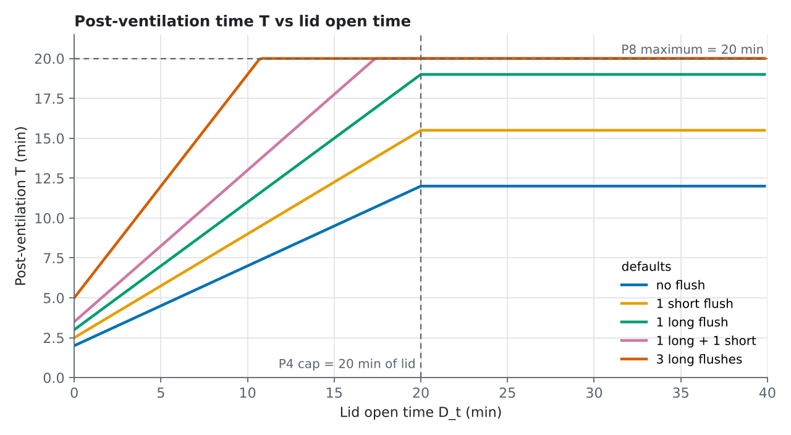
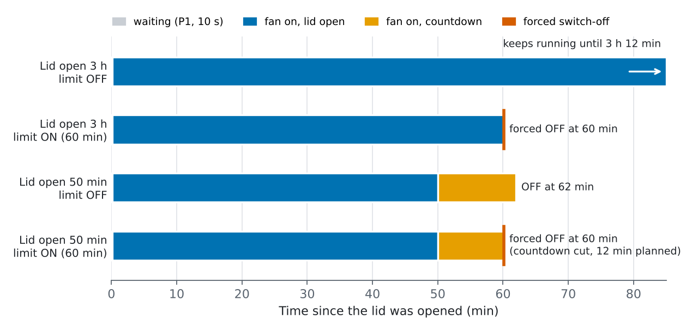

<p align="center"></p>

# Aeratore WC (WC Fan)

[](https://hacs.xyz/)


🇬🇧 [Read in English](README.md)

Integrazione custom per Home Assistant che accende e spegne l'aeratore del bagno
in base al sensore **tavoletta** e, opzionalmente, ai sensori di **scarico
breve** e **scarico lungo**, con un tempo di post-ventilazione calcolato
sull'intera sessione d'uso. Multi-istanza: una voce
per ogni bagno.

Specifica completa: [SPEC.md](SPEC.md).

## Funzionamento

1. Tavoletta aperta → dopo il **ritardo di attivazione** (P1) l'aeratore si
   accende. Uno scarico lo accende subito.
2. Finché la tavoletta è aperta o uno scarico è in corso, l'aeratore resta acceso.
3. Quando entrambi sono `off` parte un **countdown** di durata **T**:

   ```
   S = min(D_t, P4)
   T = clamp( P2 + P3 · S + n_brevi · (P5b + P6b · S) + n_lunghi · (P5 + P6 · S), P7, P8 )
   ```

   `D_t` = tempo totale di tavoletta aperta nella sessione, `n_brevi` /
   `n_lunghi` = numero di scarichi. Lo scarico è un **evento binario**: la sua
   durata non conta, vale una volta. Ogni scarico aggiunge una parte fissa
   (P5 / P5b) più una parte **proporzionale al tempo di tavoletta aperta**
   tramite un fattore configurabile (P6 / P6b). Uno scarico lungo pesa più di
   uno breve e più scarichi richiedono più aerazione. Esempio: tavoletta aperta
   300 s, uno scarico lungo e uno breve → 120 + 150 + (60 + 90) + (30 + 45) =
   **495 s**.

   Senza sensori di scarico non ci sono termini di scarico:
   T = clamp(P2 + P3 · S, P7, P8). Con i default, 1 min di tavoletta aperta →
   150 s, 10 min → 420 s.
   Se i due contatti sono `on` insieme (placche a doppio tasto) contano come
   **un solo scarico lungo**, dal primo `on` all'ultimo `off`.
4. Una nuova apertura o un nuovo scarico durante il countdown riprende la stessa
   sessione.
5. Accendendo l'aeratore **a mano** l'automazione si sospende (`manual`) finché
   l'aeratore non si spegne; spegnendolo **a mano** la sessione termina.
6. **Tempo massimo di accensione** (sicurezza): in ogni caso l'aeratore si
   spegne dopo `max_on_time` minuti dall'accensione, countdown compreso (per
   esempio con un sensore tavoletta bloccato su aperto). La sessione termina e
   ne serve una nuova apertura o un nuovo scarico. Si disattiva con
   `switch.<nome>_max_on_enabled` e si estende alla modalità manuale con
   `switch.<nome>_max_on_manual`.

7. **Timer helper** (opzionale, v1.4): seleziona un helper `timer` esistente
   (*Impostazioni → Dispositivi e servizi → Aiutanti → Timer*) e l'integrazione
   vi riflette il tempo residuo dell'aeratore, così funzionano le card standard
   dei timer e gli attributi `remaining` / `finishes_at`. Vedi *Timer helper*.

## Installazione

1. HACS → ⋮ → *Repository personalizzati* → `https://github.com/dvbit/ha-wc-fan`,
   categoria *Integrazione*.
2. Installa **WC Fan** e riavvia Home Assistant.
3. *Impostazioni → Dispositivi e servizi → Aggiungi integrazione → Aeratore WC*.

Richiede Home Assistant **2025.6.0** o successivo.

## Configurazione

| Campo | Entità | Significato |
| --- | --- | --- |
| Nome | testo | nome del dispositivo e prefisso delle entità |
| Sensore tavoletta | `binary_sensor` | `on` = tavoletta aperta (obbligatorio) |
| Sensore scarico breve | `binary_sensor` | `on` = scarico breve in corso (opzionale) |
| Sensore scarico lungo | `binary_sensor` | `on` = scarico lungo in corso (opzionale) |
| Aeratore | `switch` o `fan` | l'aeratore da comandare (obbligatorio) |
| Timer helper | `timer` | opzionale: riflette il tempo residuo, vedi sotto |

Le entità si possono cambiare in seguito da **Configura** (options flow).
I parametri di un sensore di scarico non configurato non vengono creati.

**Aggiornamento dalla 1.0:** il sensore sciacquone esistente diventa lo
scarico **lungo**; entity_id e valori restano invariati.

**Aggiornamento alla 2.0:** la formula è cambiata (lo scarico è un evento binario, vedi *Funzionamento*). I number dei fattori di durata sono sostituiti da `flush_seat_factor` / `short_flush_seat_factor` (default 0,3 / 0,15); `flush_extra` mantiene il valore.

## Entità

Esempio con nome `Bagno`. Gli entity_id sono in inglese; i nomi visualizzati
seguono la lingua di Home Assistant.

| Entità | Default | Range | Specifica |
| --- | --- | --- | --- |
| `switch.bagno_enabled` | on | — | §7 abilitato |
| `number.bagno_activation_delay` | 10 s | 0–120 | P1 ritardo attivazione |
| `number.bagno_base_time` | 120 s | 0–1800 | P2 tempo base |
| `number.bagno_seat_factor` | 0.5 s/s | 0–5 | P3 fattore tavoletta |
| `number.bagno_seat_cap` | 1200 s | 60–3600 | P4 limite tavoletta |
| `number.bagno_short_flush_extra` | 30 s | 0–600 | P5b extra per scarico breve |
| `number.bagno_short_flush_seat_factor` | 0.15 s/s | 0–2 | P6b fattore per scarico breve (per s di tavoletta) |
| `number.bagno_flush_extra` | 60 s | 0–600 | P5 extra per scarico lungo |
| `number.bagno_flush_seat_factor` | 0.3 s/s | 0–2 | P6 fattore per scarico lungo (per s di tavoletta) |
| `number.bagno_min_time` | 120 s | 0–3600 | P7 tempo minimo |
| `number.bagno_max_time` | 1200 s | 60–7200 | P8 tempo massimo (solo countdown) |
| `number.bagno_max_on_time` | 60 min | 5–240 | tempo massimo di accensione |
| `switch.bagno_max_on_enabled` | on | — | limite di accensione attivo |
| `switch.bagno_max_on_manual` | off | — | limite anche in modalità manuale |
| `sensor.bagno_state` | — | vedi sotto | §5 stato |
| `sensor.bagno_expected_end` | — | timestamp, solo in `countdown` | §3 fine prevista |

Valori di `sensor.bagno_state` (tradotti nell'interfaccia): `idle` (inattivo),
`waiting` (attesa), `active` (attivo), `countdown`, `manual` (manuale),
`disabled` (disabilitato).

Attributi: `seat_total` (D_t, s), `flush_count` (scarichi lunghi),
`short_flush_count` (scarichi brevi), `post_ventilation` (T della
sessione corrente, s), `max_on_end` (istante dello spegnimento forzato),
`last_stop_reason` (`countdown`, `max_on_time`, `manual_off`, `disabled`).

Tutti i valori sopravvivono al riavvio; una sessione interrotta viene ripresa (§8).

## Esempi di utilizzo

### Disattivare l'automazione di notte

```yaml
automation:
  - alias: "Aeratore WC - silenzio notturno"
    triggers:
      - trigger: time
        at: "23:00:00"
        id: "notte"
      - trigger: time
        at: "07:00:00"
        id: "giorno"
    actions:
      - choose:
          - conditions:
              - condition: trigger
                id: "notte"
            sequence:
              - action: switch.turn_off
                target:
                  entity_id: switch.bagno_enabled
        default:
          - action: switch.turn_on
            target:
              entity_id: switch.bagno_enabled
```

### Post-ventilazione più lunga d'inverno

```yaml
automation:
  - alias: "Aeratore WC - tempo base invernale"
    triggers:
      - trigger: state
        entity_id: sensor.season
        to: "winter"
    actions:
      - action: number.set_value
        target:
          entity_id: number.bagno_base_time
        data:
          value: 300
```

### Notifica se l'aeratore resta in manuale

```yaml
automation:
  - alias: "Aeratore WC - manuale da 1 ora"
    triggers:
      - trigger: state
        entity_id: sensor.bagno_state
        to: "manual"
        for:
          hours: 1
    actions:
      - action: notify.notify
        data:
          message: "L'aeratore del bagno è acceso a mano da 1 ora."
```

### Card per la dashboard

```yaml
type: entities
title: Aeratore bagno
entities:
  - entity: switch.bagno_enabled
  - entity: sensor.bagno_state
  - entity: sensor.bagno_expected_end
    format: relative
  - type: attribute
    entity: sensor.bagno_state
    attribute: post_ventilation
    name: Post-ventilazione (s)
```

### Tavoletta da un sensore di inclinazione/vibrazione

Se la tavoletta non ha un contatto, un helper Template (*Impostazioni →
Dispositivi e servizi → Aiutanti → Crea aiutante → Template → Sensore
binario*) può ricavarla dall'angolo di inclinazione. *Stato*:

```jinja
{{ states('sensor.vibrazione_wc_angle_x') | float(0) > 35 }}
```

*Opzioni avanzate → Disponibilità*:

```jinja
{{ has_value('sensor.vibrazione_wc_angle_x') }}
```

### Notifica quando il tempo massimo ha spento l'aeratore

```yaml
automation:
  - alias: "Aeratore WC - spento per tempo massimo"
    triggers:
      - trigger: state
        entity_id: sensor.bagno_state
        attribute: last_stop_reason
        to: "max_on_time"
    actions:
      - action: notify.notify
        data:
          message: "L'aeratore del bagno ha raggiunto il tempo massimo: controlla il sensore tavoletta."
```

## Timer helper

Campo opzionale *Timer helper* (dominio `timer`). L'integrazione lo comanda
solo con i servizi documentati `timer.start`, `timer.change` e `timer.cancel`;
la durata impostata nell'helper viene ignorata.

- Aeratore **acceso** → `timer.start`, con fine alla scadenza del tempo massimo
  di accensione (`max_on_time`). Con `max_on_enabled` off la fine non è nota
  finché la tavoletta è aperta: il timer parte all'inizio del countdown.
- Inizio del countdown → `timer.change` perché il timer finisca alla fine del
  countdown (mai oltre il tempo massimo di accensione).
- Cambio di un parametro (es. tempo base, tempo massimo) → `timer.change` con
  la differenza. Un timer non può superare la durata con cui è partito: in quel
  caso viene riavviato con `timer.start`.
- Sessione terminata prima (OFF manuale, spegnimento forzato, automazione
  disabilitata) → `timer.cancel`. Alla fine normale del countdown il timer
  termina da solo e scatta `timer.finished`.
- Modalità manuale: il timer segue il tempo massimo solo se `max_on_manual` è on.

Card per la dashboard:

```yaml
type: tile
entity: timer.aeratore_bagno
name: Tempo residuo aeratore
```

Ogni helper può riflettere una sola istanza. Un helper non disponibile viene
segnalato una volta con un warning e saltato.

## Esempi di timer

Tutti i valori usano i **default** (P1 10 s, P2 120 s, P3 0,5, P4 1200 s,
P5b 30 s, P6b 0,15, P5 60 s, P6 0,3, P7 120 s, P8 1200 s, tempo massimo di
accensione 60 min) e sono calcolati con la macchina a stati dell'integrazione.
`T` è per quanto l'aeratore continua a girare **dopo** la chiusura della
tavoletta e la fine dell'ultimo scarico.

```
S = min(D_t, 1200)
T = clamp( 120 + 0,5·S + n_brevi · (30 + 0,15·S) + n_lunghi · (60 + 0,3·S), 120, 1200 )
```

### Diversi tempi di tavoletta e scarichi

| # | Tavoletta aperta (D_t) | Scarichi | Calcolo | T |
| --- | --- | --- | --- | --- |
| 1 | 30 s | nessuno | 120 + 15 | **135 s** (2 min 15 s) |
| 2 | 30 s | 1 breve | 120 + 15 + (30 + 4,5) | **169,5 s** (2 min 50 s) |
| 3 | 2 min | 1 lungo | 120 + 60 + (60 + 36) | **276 s** (4 min 36 s) |
| 4 | 5 min | 1 lungo + 1 breve | 120 + 150 + (60 + 90) + (30 + 45) | **495 s** (8 min 15 s) |
| 5 | 10 min | 2 lunghi | 120 + 300 + 2 · (60 + 180) | **900 s** (15 min) |
| 6 | 25 min | 1 lungo | 120 + 600 *(S limitato da P4)* + (60 + 360) | **1140 s** (19 min) |
| 7 | 30 min | 10 lunghi | 120 + 600 + 10 · (60 + 360) = 4920 → limitato da P8 | **1200 s** (20 min) |

### Stessa tavoletta (5 min), diverso numero di scarichi

| Scarichi | Calcolo | T |
| --- | --- | --- |
| nessuno | 120 + 150 | **270 s** (4 min 30 s) |
| 1 breve | 270 + (30 + 45) | **345 s** (5 min 45 s) |
| 1 lungo | 270 + (60 + 90) | **420 s** (7 min) |
| 2 lunghi | 270 + 2 · 150 | **570 s** (9 min 30 s) |
| 3 lunghi | 270 + 3 · 150 | **720 s** (12 min) |

L'aeratore si accende 10 s dopo l'apertura (P1). Senza sensori di scarico
contano solo i primi due termini (righe 1, 3 e 5 darebbero 135 s, 180 s e 420 s).



### Tavoletta lasciata aperta: con e senza tempo massimo

L'aeratore si accende a 10 s e la tavoletta non si chiude (o si chiude tardi).
Tempo massimo di accensione = 60 min (`max_on_time`), contato dall'accensione
dell'aeratore, **countdown compreso**.

| Caso | `max_on_enabled` | Spegnimento | `last_stop_reason` |
| --- | --- | --- | --- |
| Tavoletta aperta 3 h | off | 3 h 12 min dopo l'apertura (3 h + T = 12 min) | `countdown` |
| Tavoletta aperta 3 h | on | **60 min** dopo l'accensione (a 60 min 10 s) | `max_on_time` |
| Tavoletta aperta 50 min | off | 62 min (50 min + T = 12 min) | `countdown` |
| Tavoletta aperta 50 min | on | **60 min 10 s**: il countdown di 12 min viene troncato | `max_on_time` |
| Tavoletta aperta 20 min | on | 32 min (20 min + T = 12 min), limite non raggiunto | `countdown` |

Dopo uno spegnimento forzato la sessione termina: l'aeratore riparte solo con
una nuova apertura o un nuovo scarico, anche se la tavoletta è ancora aperta.



## Log

```yaml
logger:
  logs:
    custom_components.wc_fan: debug
```

- **DEBUG**: ogni transizione di stato con causa, D_t, S, T calcolato.
- **INFO**: apertura/chiusura sessione, override manuale, abilitazione, avvio.
- **WARNING**: aeratore non disponibile o comando fallito, sensore non disponibile.
- **ERROR**: configurazione non valida.

## Lingue

English, Italiano, Français, Español, Deutsch.

## Licenza

MIT
